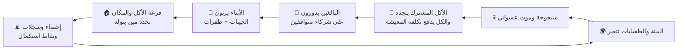

  

  
  
  
  

  <a href="README.md">English</a> · <b>العربية</b>

# مختبر التطور — Evolution Lab

**مختبر التطور** محاكي مفتوح المصدر يحاول الإجابة عن واحد من أقدم ألغاز علم الأحياء:

> **ليش أغلب الكائنات المعقدة تتكاثر بأبوين، مع إن نسخ النفس (الاستنساخ) أسرع بمرتين؟**

البرنامج يحط سبع طرق تكاثر داخل **نفس العالم الصغير**: أكل مشترك ومحدود، بيئة تتغير، طفيليات، شيخوخة وموت. ويخليها تتنافس، وبعدها يعرض لك بالرسوم البيانية — ومع هوامش عدم اليقين بكل أمانة — مين زاد، ومين نقص، ومين انقرض. وكمان يجرّب أنظمة **مخترعة** بأربع وثمان آباء عشان يسأل: «ليش اثنين بالذات وليس أكثر؟».

وقلب المشروع هو **المختبر الحي في المتصفح**: تصمم التجربة، وتتفرج على ثلاث بيئات وهي تتطور لحظة بلحظة، وتطلق كوارث، وتشيل منافسين، وتفحص جينات أي فرد، وتصدّر كل شي — وكله يشتغل محليًا على جهازك.

كل شي قابل للإعادة: نفس البذرة العشوائية تعطي نفس النتيجة، كل تشغيل ينحفظ مع نقاط استكمال، و254 اختبار آلي تتأكد من صحة الحسابات.

  

## ⬇️ التحميل والتشغيل في دقيقتين

**1. ثبّت Python 3.13 أو أحدث** من [python.org](https://www.python.org/downloads/) — على ويندوز فعّل خيار **"Add python.exe to PATH"** أثناء التثبيت.

**2. حمّل المشروع**

| الطريقة | الخطوات |
|---|---|
| 📦 **ملف zip جاهز** | [**Evolution-Lab-v0.7.0.zip**](https://github.com/ASSOLI99/-genetic_algorithm_for_evolution_theory/raw/main/release/Evolution-Lab-v0.7.0.zip) ← بعدها كليك يمين ← *Extract All* |
| 🟢 زر GitHub | من أعلى الصفحة: **Code ← Download ZIP** |
| 🧑‍💻 Git | `git clone https://github.com/ASSOLI99/-genetic_algorithm_for_evolution_theory.git` |

**3. شغّله**

| النظام | الخطوة |
|---|---|
| 🪟 **ويندوز** | دبل كليك على **`START-WINDOWS.bat`** واضغط <kbd>Enter</kbd> |
| 🍎 **ماك** / 🐧 **لينكس** | افتح الطرفية داخل المجلد واكتب `./start.sh` |

بس كذا! أول مرة ينشئ بيئة خاصة (`.venv`) ويثبت نفس إصدارات المكتبات بالضبط (كم دقيقة، مرة وحدة بس). بعدها **المختبر الحي بيفتح في المتصفح** على `http://127.0.0.1:8765`. خلّي نافذة التشغيل مفتوحة طول ما أنت شغال، وسكّرها لما تخلص. ما ينثبت شي على مستوى الجهاز، وما ينبعث شي لبرّا، والنتائج تنحفظ داخل مجلد `runs`.

### كل اللي يقدر يسويه المشغّل

| رقم القائمة | خيار `start.sh` | شو تسوي | الحجم |
|:---:|---|---|---|
| **1** | *(بدون)* أو `gui` | 🖥️ **المختبر الحي** — الواجهة الرسومية | أنت تحدد |
| **2** | `smoke` | عرض سريع بتقرير للتأكد إن كل شي شغال | 4 سيناريوهات × تكرارين، حوالي دقيقة |
| **3** | `standard` | المقارنة الكاملة الجاهزة | 144 سيناريو × 8 تكرارات (1,152 تشغيل)، حوالي 10 دقائق |
| **4** | `isolated` | كل طريقة لحالها بنفس العدد الابتدائي | 42 سيناريو × 8 تكرارات |
| **5** | `invasion` | 8 أفراد «يخلطون أحيانًا» وسط 216 فرد مستنسخ | 4 سيناريوهات × 16 تكرار، 200 خطوة |
| **6** | `catastrophe` | صدمة سكانية وجفاف والاثنين مع بعض، مقابل بدون كوارث | 16 سيناريو × 4 تكرارات، 400 خطوة |

الخيارات 2–6 تشغّل الاختبارات أول، وبالآخر تفتح `REPORT.html`.

## 🖥️ المختبر الحي

صمّم التجربة من اللوحة الجانبية، اضغط **ابدأ تجربة جديدة**، وتابع. كل رقم تشوفه طالع من محرك المحاكاة الحقيقي، مش رسوم متحركة.

| | |
|---|---|
| 🧪 **صمّم التجربة** | منافسة مشتركة (كل الطرق بنفس العالم) **أو** عوالم منفصلة (كل طريقة لحالها — 21 عالم)؛ اختار بالتشيك بوكس أي طرق من السبعة تشارك؛ المدة، الدقة، السعة، عدد البداية، ميزانية الأكل، الطفرات، تكاليف التزاوج، الانتخاب، التوافق، قاعدة وراثة الـ4/8 آباء، الطفيليات والبذرة |
| 🌍 **ثلاث بيئات حية** | ثابتة ودورية ومتقلبة جنب بعض، لكل وحدة سكانها ومخزون أكلها وعينة حية من أفرادها |
| ⚡ **الكوارث** | صدمة سكانية أو جفاف أو الاثنين؛ تحدد البيئة، نسبة الوفيات، خسارة الأكل، المدة وتجدد الأكل. كارثة وحدة بكل مرة مع فترة انتظار |
| ✂️ **شيل منافس** | امسح طريقة تكاثر كاملة من بيئة أو من كل البيئات وشوف مين بياخذ مكانها — وتنسجل منفصلة عن الانقراض الطبيعي |
| 📈 **رسوم حية** | السكان أو الأكل مع الوقت لكل بيئة، مع علامات التدخلات |
| 🧬 **افحص أي شي** | اضغط على أي نقطة تشوف طريقة تكاثر الفرد وعمره وأداءه وجيناته؛ واضغط على أي طريقة تشوف أكثر من 20 مقياس (مواليد، فشل إيجاد شريك، التنوع، الارتباط، وقت الانقراض…) |
| ⏯️ **تحكم كامل** | إيقاف مؤقت، متابعة، إنهاء، سرعة العرض؛ وتقدير لحمل الجهاز قبل كل تشغيل |
| 💾 **حفظ وإعادة** | تصدير تقرير HTML ونقاط استكمال وسجلات وجدول الصمود وسجل التدخلات كملف ZIP؛ والجلسة تنعاد بالضبط |

<table>
<tr>
<td width="50%"> <b>رسم السكان الحي.</b> النزلة قرب 18 مليون هي كارثة انطلقت من اللوحة؛ وبعدها طريقة «اختياري» (الأصفر) سيطرت على هالبيئة.</td>
<td width="50%"> <b>جدول المجتمع</b> مع أوقات الانقراض بالضبط، و<b>سجل التدخلات</b>.</td>
</tr>
<tr>
<td width="50%" align="center"> <b>لوحة الكوارث:</b> صدمة سكانية، جفاف، أو مركّبة.</td>
<td width="50%" align="center"> <b>فحص الفرد:</b> اضغط أي نقطة تشوف جيناتها.   <b>قبل كل تشغيل</b> المختبر يعرض الحمل المتوقع.</td>
</tr>
</table>

> «ملايين السنين» بالمختبر مقياس عرض يتوزع على عدد التحديثات الفعلية اللي تختارها، مش زمن جيولوجي معاير. التفاصيل في [`GUI_PROTOCOL.md`](GUI_PROTOCOL.md) و[`RUN_ME_AR.md`](RUN_ME_AR.md).

## 📸 تقارير التجارب الجاهزة

<table>
<tr>
<td width="50%"> <b>التقرير</b> يفتح تلقائيًا: ملخص ورسوم وجدول بهوامش عدم اليقين لكل سيناريو.</td>
<td width="50%"> <b>عدد الأفراد مع الوقت</b> (يسار) و<b>منحنيات البقاء</b> (يمين) في أقسى عالم (تكاليف تزاوج، بيئة متقلبة، طفيليات متتبعة): في هذا التشغيل المستنسخين والخالطين أحيانًا زادوا، وأنظمة الـ4 والـ8 آباء انهارت.</td>
</tr>
<tr>
<td colspan="2" align="center"> <b>العدد النهائي حسب السيناريو</b> — كل صف عالم مختلف (تكاليف × بيئة × طفيليات …). اللون الأفتح = أفراد أكثر في النهاية. الفائز يتغير مع تغيّر العالم، وهذي هي الفكرة بالضبط.</td>
</tr>
</table>

## 🧬 الفكرة

التكاثر الجنسي يبين وكأنه صفقة خاسرة. المستنسخ يورّث 100% من جيناته وكل فرد يقدر يخلّف، أما الكائن الجنسي لازم يلقى شريك متوافق، ويدفع تكلفة التزاوج، ويورّث نص جيناته بس. طيب ليش الجنس منتشر في كل مكان؟

الفرضيات المشهورة تقول إن خلط الجينات يستاهل لما **البيئة تتغير باستمرار**، أو لما **الطفيليات تتكيف** مع النمط الجيني الأكثر انتشارًا (فكرة *الملكة الحمراء*). مختبر التطور يحوّل هذي الأفكار لتجربة مضبوطة تقدر تشغلها وتعيدها بنفسك.

### المتنافسين السبعة

| الطريقة | كيف تتكاثر |
|---|---|
| 🔵 `clone` | تنسخ الجينوم كامل — ما تحتاج شريك |
| 🟠 `two_parent` | لازم شريك دائمًا، والابن ياخذ نص معاد تركيبه من كل أب |
| 🟢 `facultative` | غالبًا تستنسخ، وتخلط باحتمال موروث **يقدر يتطور** |
| 🔴 `periodic` | تخلط في أوقات محددة وتستنسخ في الباقي |
| 🟣 `stress` | تخلط بس لما يكون أداؤها ضعيف في البيئة الحالية |
| 🟤 `four_parent` | **مخترعة:** كل ابن له 4 آباء جينيين |
| 🩷 `eight_parent` | **مخترعة:** كل ابن له 8 آباء جينيين |

أنظمة الـ4 والـ8 آباء غير موجودة في الطبيعة؛ هي آليات «ماذا لو» (ونختبر قاعدتين مختلفتين للوراثة) عشان نسأل: هل الخلط الأكثر أفضل؟ ولا إن البحث عن شركاء كثير مكلف زيادة؟

### كيف تمشي خطوة زمنية واحدة

- **الجينوم** ثنائي الصيغة (نسختين من كل كروموسوم)، مع إعادة تركيب حقيقية وسيادة وطفرات.
- **الصلاحية** = مدى توافق جينات الفرد مع البيئة الحالية، ناقص ضرر الطفيليات اللي تستهدف الجينات الشائعة.
- **تكاليف عادلة:** كل الطرق تاخذ نفس الجهد التكاثري المتوقع، والطرق اللي تخلط تدفع تكلفة تزاوج وتكلفة شركاء إضافيين معلنة (والتجربة تختبر كمان عوالم بتكلفة صفر).
- **محاسبة صارمة:** الأكل وعدد السكان يتوازنون في كل خطوة. لو صار أي خلل، التشغيل يوقف بدل ما يطلع نتائج غلط بصمت.

### شو اللي يتغير في المقارنة الكاملة

`تكلفة التزاوج (0 / 0.2)` × `تكلفة الشريك الإضافي (0 / 0.04)` × `البيئة (ثابتة / دورية / عشوائية)` × `الطفيليات (بدون / ثابتة / متتبعة)` × `قاعدة الـ4/8 آباء (نوعين)` × `مين يتزاوج مع مين (نوعين)` = **144 عالم**، كل واحد يتعاد 8 مرات ببذور مستقلة.

## 📂 شو تحصل بعد التشغيل

- `REPORT.html` ← افتح هذا أول شي
- `comparison.csv` ← كل الأرقام مع فترات الثقة
- `scenario_index.csv` ← إعدادات كل سيناريو
- `analysis.json` ← الإحصاءات والبذور وبصمات الملفات
- صور `png/svg` للرسوم، ومجلد لكل تشغيل فيه السجلات التفصيلية ونقاط الاستكمال

لو انقطع التشغيل، شغله مرة ثانية بنفس المجلد ويكمل من آخر نقطة محفوظة — التفاصيل في [`RUN_ME_AR.md`](RUN_ME_AR.md).

## ⚠️ اقرأ قبل ما تستنتج

هذا **نموذج تجريبي مبسّط بفرضيات واضحة ومعلنة**، وليس نموذجًا معايَرًا لكائن حي حقيقي. ثمان تكرارات تعطي مقارنة استكشافية غير دقيقة. أنظمة الـ4 والـ8 آباء مخترعة. لما طريقة «تفوز» في بعض السيناريوهات، المعنى «تحت هذي الفرضيات» وليس «هكذا تعمل الطبيعة». التفاصيل في [`LIMITATIONS.md`](LIMITATIONS.md).

## 📚 ملفات التوثيق

| الملف | المحتوى |
|---|---|
| [`RUN_ME_AR.md`](RUN_ME_AR.md) | دليل التشغيل المفصل بالعربي |
| [`ECO_MODEL.md`](ECO_MODEL.md) | تعريف النموذج البيئي وكل فرضياته (إنجليزي) |
| [`ECO_PROTOCOL.md`](ECO_PROTOCOL.md) | تصميم التجربة والإحصاء (إنجليزي) |
| [`LIMITATIONS.md`](LIMITATIONS.md) | حدود النموذج (إنجليزي) |
| [`ARCHITECTURE.md`](ARCHITECTURE.md) | هيكلة الكود (إنجليزي) |
| [`GUI_PROTOCOL.md`](GUI_PROTOCOL.md) | قواعد المختبر الحي: الزمن والموارد والإعادة (إنجليزي) |
| [`DISTURBANCE_PROTOCOL.md`](DISTURBANCE_PROTOCOL.md) | الكوارث والجفاف (إنجليزي) |

## 🤝 المساهمة

الأفكار والتجارب الجديدة وتحسين الرسوم والترجمة كلها مرحب فيها. شوف [`CONTRIBUTING.md`](CONTRIBUTING.md) أو افتح [Issue](https://github.com/ASSOLI99/-genetic_algorithm_for_evolution_theory/issues).

## 📄 الرخصة

المشروع منشور تحت [رخصة MIT](LICENSE) — تقدر تستخدمه وتعدّله وتنشره بحرية مع ذكر المصدر. للاستشهاد العلمي شوف [`CITATION.cff`](CITATION.cff).

