<p align="center">
  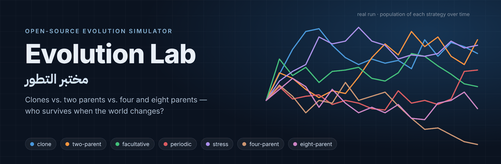
</p>

<p align="center">
  <a href="https://github.com/ASSOLI99/-genetic_algorithm_for_evolution_theory/actions/workflows/tests.yml"></a>
  
  
  
  <a href="LICENSE"></a>
</p>

<p align="center">
  <b>English</b> · <a href="README.ar.md">العربية</a>
</p>

---

**Evolution Lab** is an open-source simulator that asks one of biology's oldest puzzles:

> **Why do most complex organisms reproduce with two parents, when copying yourself is twice as fast?**

It drops seven reproduction strategies into the *same* small world — shared food, a changing environment, parasites, aging and death — and lets them compete. Then it shows you, with charts and honest uncertainty, who grew, who shrank and who went extinct. It even tests *invented* four- and eight-parent systems to ask "why two and not more?".

The heart of the project is a **live laboratory in your browser**: design the experiment, watch three worlds evolve in real time, launch catastrophes, remove competitors, inspect any individual's genome, and export everything — all running locally on your own machine.

Everything is reproducible: the same seed gives the same result, every run is saved with checkpoints, and 254 automated tests check the bookkeeping.

<p align="center">
  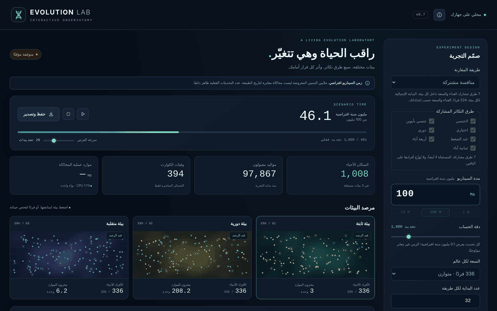
</p>

## ⬇️ Download and run in 2 minutes

**1. Install Python 3.13 or newer** from [python.org](https://www.python.org/downloads/) (on Windows, tick **"Add python.exe to PATH"**).

**2. Download the project**

| Option | How |
|---|---|
| 📦 **Ready-made zip** | [**Evolution-Lab-v0.8.0.zip**](https://github.com/ASSOLI99/-genetic_algorithm_for_evolution_theory/raw/main/release/Evolution-Lab-v0.8.0.zip) — then right-click → *Extract All* |
| 🟢 GitHub button | **Code → Download ZIP** at the top of this page |
| 🧑‍💻 Git | `git clone https://github.com/ASSOLI99/-genetic_algorithm_for_evolution_theory.git` |

**3. Start it**

| System | What to do |
|---|---|
| 🪟 **Windows** | Double-click **`START-WINDOWS.bat`** and press <kbd>Enter</kbd> |
| 🍎 **macOS** / 🐧 **Linux** | Open a terminal in the folder and run `./start.sh` |

That's it. The first run creates a private environment (`.venv`) and installs the exact library versions (a few minutes, once). Then **the live laboratory opens in your browser** at `http://127.0.0.1:8765`. Keep the launcher window open while you use it; close it to stop. Nothing is installed system-wide, nothing is sent anywhere, and results are saved in the `runs/` folder.

### Everything the launcher can do

| Menu | `start.sh` argument | What it does | Size |
|:---:|---|---|---|
| **1** | *(none)* or `gui` | 🖥️ **Live laboratory** — the graphical interface | you choose |
| **2** | `smoke` | Quick batch demo — checks everything works, opens a report | 4 scenarios × 2 replicates, ~1 min |
| **3** | `standard` | The full prepared comparison | 144 scenarios × 8 replicates (1,152 runs), ~10 min |
| **4** | `isolated` | Each strategy alone, same starting size | 42 scenarios × 8 replicates |
| **5** | `invasion` | 8 "sometimes-sexual" mutants dropped among 216 clones | 4 scenarios × 16 replicates, 200 steps |
| **6** | `catastrophe` | Bottlenecks, droughts and both, vs. no disaster | 16 scenarios × 4 replicates, 400 steps |

Batch profiles (2–6) run the test suite first and open a `REPORT.html` when done.

## 🖥️ The live laboratory

Design an experiment in the side panel, press **ابدأ تجربة جديدة** (start), and watch it unfold. The interface is in Arabic (RTL); every number comes from the real simulation engine, not an animation.

| | |
|---|---|
| 🧪 **Design the experiment** | Shared competition (all strategies in each world) **or** isolated worlds (each strategy alone — 21 worlds); tick which of the 7 strategies take part; duration, resolution, **capacity per world — any number you type, or ∞ for no ceiling (then only food limits reproduction)**, starting population, food budget, mutation, mating costs, selection, compatibility, 4/8-parent inheritance rule, parasites and seed |
| 🌍 **Three living environments** | Static, periodic and drifting worlds side by side, each with its own population, food stock and a live sample of individuals |
| ⚡ **Catastrophes** | Population bottleneck, drought or both; choose target, mortality, food loss, duration and food renewal. One at a time, with a cooldown |
| ✂️ **Remove a competitor** | Wipe out one strategy in one or all environments and see who takes its place — logged separately from natural extinction |
| 📈 **Live charts** | Population or food over time, per environment, with intervention markers |
| 🧬 **Inspect anything** | Click a dot to see that individual's strategy, age, performance and genome; click a strategy for 20+ metrics (births, failures to find mates, diversity, linkage, extinction time…) |
| ⏯️ **Full control** | Pause, resume, stop, speed slider; a resource estimate before every run |
| 💾 **Save & replay** | Export an HTML report, checkpoints, ledgers, survival table and an exact intervention journal as a ZIP; sessions can be replayed bit-for-bit |

<table>
<tr>
<td width="50%">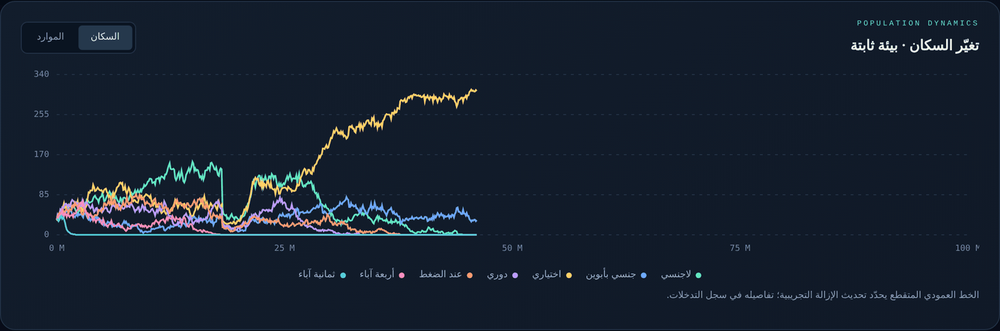<br><sub><b>Live population chart.</b> The drop near 18 M is a catastrophe launched from the panel; afterwards the facultative mixers (yellow) take over this world.</sub></td>
<td width="50%">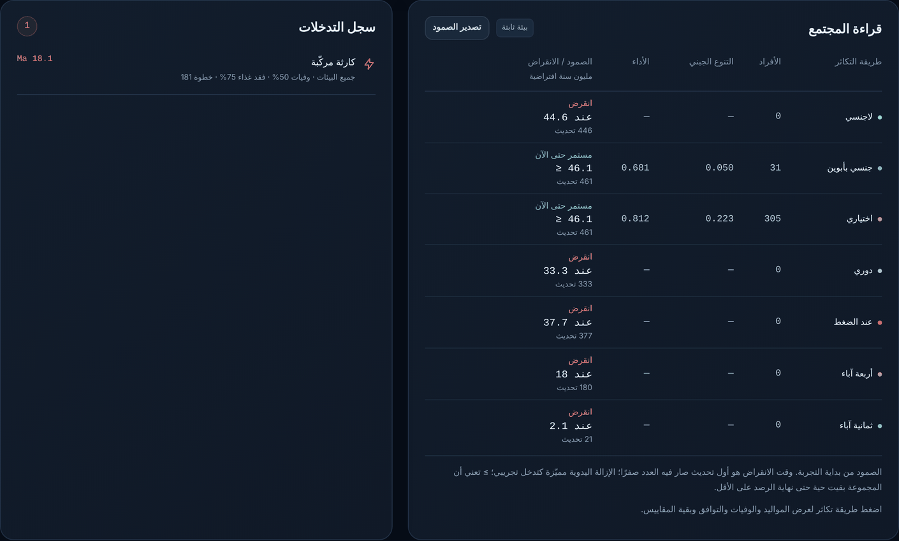<br><sub><b>Community table</b> with exact extinction times, plus the <b>intervention log</b>.</sub></td>
</tr>
<tr>
<td width="50%" align="center">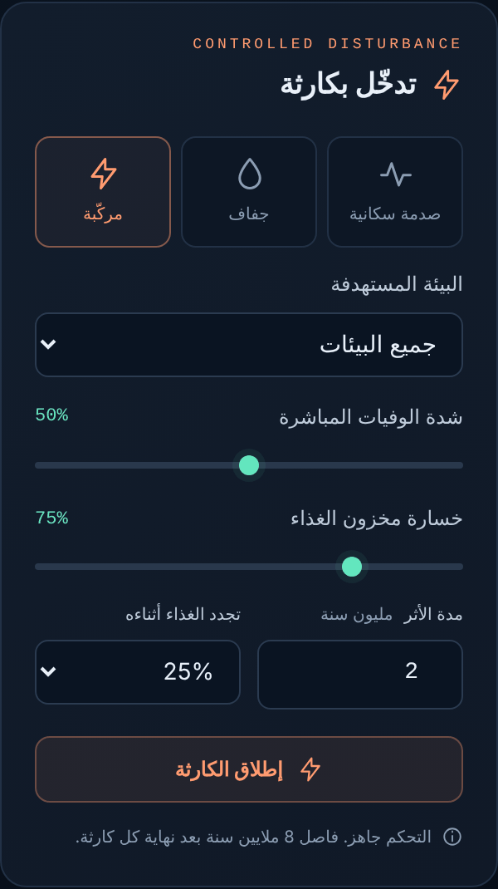<br><sub><b>Catastrophe panel:</b> bottleneck, drought or combined.</sub></td>
<td width="50%" align="center">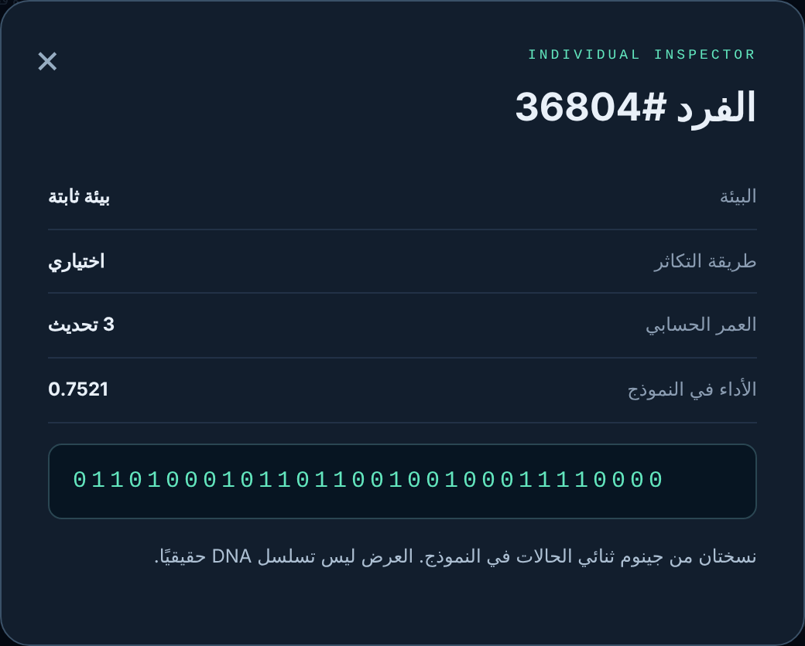<br><sub><b>Individual inspector:</b> click any dot to see its genome.</sub><br><br>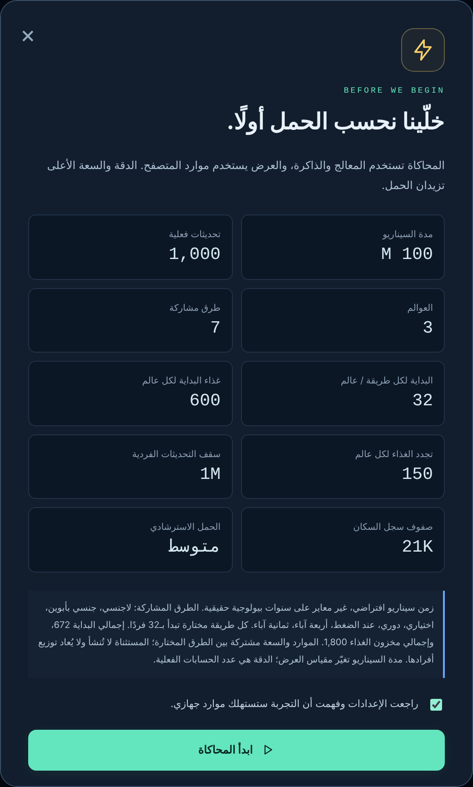<br><sub><b>Before each run</b> the lab shows the expected load.</sub></td>
</tr>
</table>

> The scenario clock ("millions of years") is a display scale spread over the number of real updates you choose; it is not calibrated geological time. Full details: [`GUI_PROTOCOL.md`](GUI_PROTOCOL.md).

## 📸 Batch reports

<table>
<tr>
<td width="50%">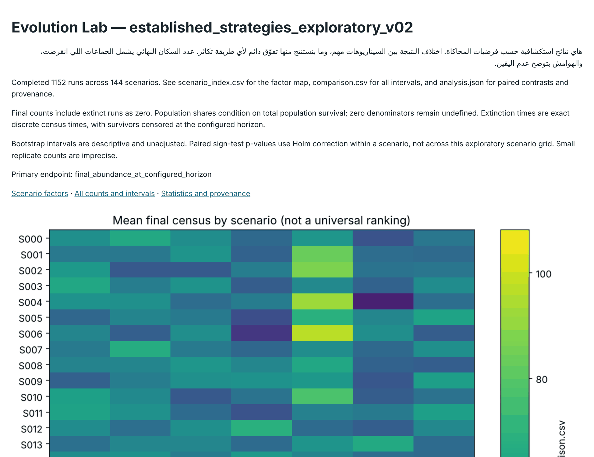<br><sub><b>The report</b> opens automatically: summary, charts and a table with uncertainty for every scenario.</sub></td>
<td width="50%">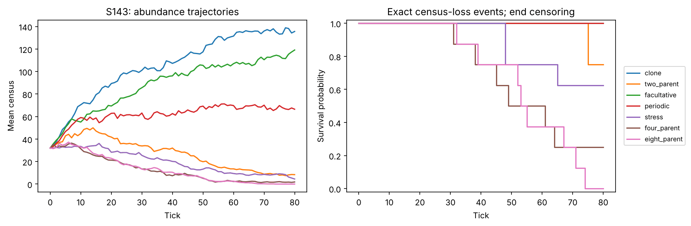<br><sub><b>Population over time</b> (left) and <b>survival curves</b> (right) in the harshest world (mating costs, drifting environment, tracking parasites): in this run, clones and facultative mixers grew while the 4- and 8-parent systems collapsed.</sub></td>
</tr>
<tr>
<td colspan="2" align="center">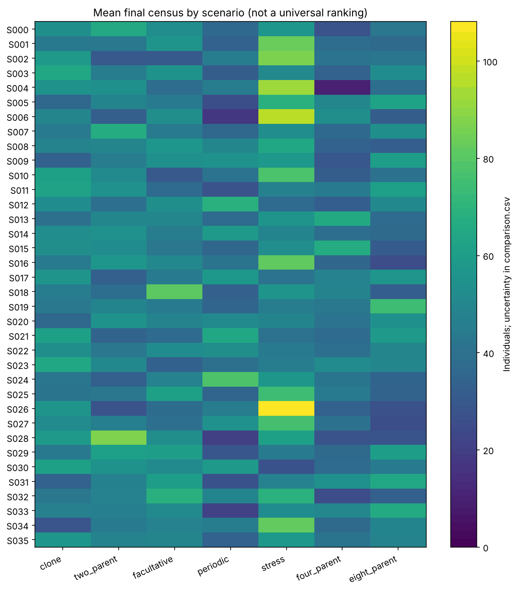<br><sub><b>Final population by scenario</b> — each row is one world (costs × environment × parasites × …). Brighter = more individuals left at the end. The winner changes with the world, which is exactly the point.</sub></td>
</tr>
</table>

## 🧬 The idea

Sexual reproduction looks like a bad deal. A clone passes on 100 % of its genes and every individual can have babies; a sexual organism must find a compatible partner, pays a mating cost, and passes on only half of its genes. So why is sex everywhere?

Classic hypotheses say mixing genes pays off when **the environment keeps changing** or when **parasites keep adapting** to the most common genotype (the *Red Queen* idea). Evolution Lab turns those ideas into a controlled experiment you can run and rerun.

### The seven contestants

| Strategy | How it reproduces |
|---|---|
| 🔵 `clone` | Copies its whole genome — no partner needed |
| 🟠 `two_parent` | Always needs a partner; offspring get a recombined half from each parent |
| 🟢 `facultative` | Usually clones, mixes with an inherited, *evolvable* probability |
| 🔴 `periodic` | Mixes on a fixed schedule, clones otherwise |
| 🟣 `stress` | Mixes only when it is doing badly in the current environment |
| 🟤 `four_parent` | **Invented:** every child has 4 genetic parents |
| 🩷 `eight_parent` | **Invented:** every child has 8 genetic parents |

The 4/8-parent systems don't exist in nature; they are "what-if" mechanisms (two different inheritance rules are tested) to ask whether *more* mixing would be even better — or whether finding many partners costs too much.

### How one time step works

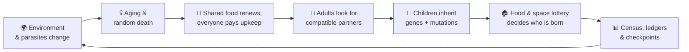

- **Genomes** are diploid (two copies of each chromosome), with real recombination, dominance and mutation.
- **Fitness** = how well an individual's genes match the current environment, minus the damage from parasites that target common genes.
- **Fair costs:** every strategy gets the same expected reproductive effort; mixing strategies pay declared mating and extra-partner costs (the grid also tests zero-cost worlds).
- **Strict accounting:** food and population are balanced every step (`after = before + renewal − spending`). If anything doesn't add up, the run stops instead of producing silent errors.

### What gets varied (the standard comparison)

`mating cost (0 / 0.2)` × `extra-partner cost (0 / 0.04)` × `environment (static / periodic / random drift)` × `parasites (none / fixed / tracking)` × `4/8-parent rule (2 kinds)` × `who can mate with whom (2 kinds)` = **144 worlds**, each replayed 8 times with independent seeds.

## 📂 What you get after a run

```
runs/smoke_20261103_062550/
├── REPORT.html          ← open this
├── REPORT.md
├── comparison.csv       every number + confidence intervals
├── scenario_index.csv   which settings each scenario used
├── analysis.json        statistics, seeds, file fingerprints
├── final_abundance_*.png/svg, trajectories_*.png/svg
└── S000_R000/ ...       per-run metrics, ledgers, events, full parentage, checkpoints
```

Interrupted? Run again with the same folder and it resumes from the last checkpoint:

```powershell
powershell -NoProfile -ExecutionPolicy Bypass -File .\Start-Experiment.ps1 -Profile standard -Output '.\runs\YOUR_FOLDER' -Resume
```

## 🛠️ For developers

<details>
<summary><b>Manual setup and command-line interface</b></summary>

```bash
python -m venv .venv
# Windows: .venv\Scripts\python.exe   macOS/Linux: .venv/bin/python
.venv/bin/python -m pip install -r requirements-dev.lock
.venv/bin/python -m pip install -e ".[dev]"
.venv/bin/python -m pytest -q
```

```bash
# Show an experiment plan without running it
python -m evolution_lab_v2 experiment --config configs/comparison_ready.json --plan-only
# Run / resume a batch
python -m evolution_lab_v2 experiment --config configs/comparison_smoke.json --output runs/my_run
python -m evolution_lab_v2 experiment --config configs/comparison_smoke.json --output runs/my_run --resume
# Small fixed-size reference engine (clone vs. two parents)
python -m evolution_lab_v2 simulate --config configs/neutral_two_parent.json --output runs/two_parent
python -m evolution_lab_v2 sweep --config configs/neutral_clone.json --grid configs/neutral_grid.json --replicates 4 --seed 20261020 --output runs/neutral_pilot
python -m evolution_lab_v2 analyze --input runs/neutral_pilot --output runs/neutral_pilot/analysis_repeat.json
python -m evolution_lab_v2 benchmark --config configs/neutral_clone.json --sizes 100,500,1000 --generations 10 --repeats 3 --output reports/benchmark_reference.json
# Integrity audit of the preserved original simulation
python tools/audit_baseline.py
# Live laboratory without the launcher (binds to 127.0.0.1 only)
python -m evolution_lab_v2 gui --port 8765            # add --no-open to skip the browser
# Plan a hypothetical calendar horizon without running it
python -m evolution_lab_v2 plan-time --config configs/catastrophe_benchmark.json --years 100000000 --years-per-step 1 --replicates 8 --output reports/deep_time_plan.json
# Survival-accounting audit (168 runs): freeze the plan, then run/resume it
python tools/audit_survival.py --output runs/my_survival_audit --plan-only
python tools/audit_survival.py --output runs/my_survival_audit --resume
python -m tools.audit_survival_smallfounders --primary runs/my_survival_audit --output runs/my_smallfounders_audit
# Frontend survival-contract checks (optional, needs Node.js)
node --test tests/gui_survival.test.cjs
```

The calendar mapping in `plan-time` is a user assumption that needs biological calibration; the planner reports workload and does not bypass the safety limits. The survival audit (`SURVIVAL_AUDIT_PROTOCOL.md`) checks the life cycle with neutral, compatibility, competition, crossover and isolated-population controls without changing engine parameters. Version 0.2 checkpoints require version 0.2 code; migration is not implicit.

Output directories must be new. Resume requires the same config, code, protocol files and library versions — this is what makes results reproducible.

To build your own experiment, copy a file in `configs/` and change the `grid`. Unknown or unsafe settings are rejected with a clear error.

The repository ships source, tests, configs and methods. Generated runs, the historical v0.1 results CSV and unpublished research notes are not distributed; the two tests that compare against that CSV are skipped when it is absent, while source-integrity and determinism checks still run.

</details>

<details>
<summary><b>Project layout</b></summary>

```
├── START-WINDOWS.bat        one-click launcher (Windows)
├── start.sh                 one-click launcher (macOS / Linux)
├── Start-GUI.ps1            PowerShell launcher for the live laboratory
├── Start-Experiment.ps1     PowerShell launcher for batch experiments, with resume
├── configs/                 ready-made experiments (JSON)
├── src/evolution_lab_v2/
│   ├── ecology.py           the demographic engine (7 strategies, food, parasites)
│   ├── eco_genetics.py      2/4/8-parent inheritance rules
│   ├── eco_experiment.py    batch plans, seeds, resume
│   ├── eco_analysis.py      statistics, charts, HTML report
│   ├── gui_server.py        local web server for the live laboratory
│   ├── gui_session.py       live sessions: worlds, catastrophes, removals, replay
│   ├── web/                 the laboratory's interface (HTML/CSS/JS, no external libraries)
│   ├── planning.py          deep-time workload planner
│   ├── model.py, genetics.py  fixed-size mathematical reference engine
│   └── cli.py               command-line interface
├── tests/                   254 automated tests (+ a Node.js frontend check)
├── tools/                   baseline audit and evidence summaries
└── evolution_lab_verified.py  original v0.1 simulation, byte-preserved
```

</details>

### Documentation

| File | Read it for |
|---|---|
| [`ECO_MODEL.md`](ECO_MODEL.md) | Exact definition of the ecological model and every assumption |
| [`ECO_PROTOCOL.md`](ECO_PROTOCOL.md) | The experiment design, endpoints and statistics, fixed before running |
| [`LIMITATIONS.md`](LIMITATIONS.md) | What this model can **not** tell you |
| [`ARCHITECTURE.md`](ARCHITECTURE.md) | Code structure and development gates |
| [`MODEL_ASSUMPTIONS.md`](MODEL_ASSUMPTIONS.md) · [`EXPERIMENT_PROTOCOL.md`](EXPERIMENT_PROTOCOL.md) | The fixed-size reference engine |
| [`GUI_PROTOCOL.md`](GUI_PROTOCOL.md) | The live laboratory: time scale, resources, model and replay contract |
| [`DISTURBANCE_PROTOCOL.md`](DISTURBANCE_PROTOCOL.md) | Catastrophes and droughts |
| [`SURVIVAL_AUDIT_PROTOCOL.md`](SURVIVAL_AUDIT_PROTOCOL.md) · [`SURVIVAL_SMALL_FOUNDERS_PROTOCOL.md`](SURVIVAL_SMALL_FOUNDERS_PROTOCOL.md) | Independent checks of survival and extinction accounting |
| [`RUN_ME_AR.md`](RUN_ME_AR.md) | Detailed run guide in Arabic |

## ⚠️ Read before drawing conclusions

This is a **toy model with transparent, declared assumptions** — not a calibrated model of any real species. Eight replicates give an exploratory, imprecise comparison. The four- and eight-parent systems are invented. A strategy "winning" in some scenarios means *"under these assumptions"*, never *"this is how nature works"*. See [`LIMITATIONS.md`](LIMITATIONS.md).

## 🤝 Contributing

Ideas, new experiment configs, better charts and translations are welcome. See [`CONTRIBUTING.md`](CONTRIBUTING.md) and open an [issue](https://github.com/ASSOLI99/-genetic_algorithm_for_evolution_theory/issues).

## 📄 License and citation

Released under the [MIT License](LICENSE). If you use it in research or teaching, see [`CITATION.cff`](CITATION.cff).
